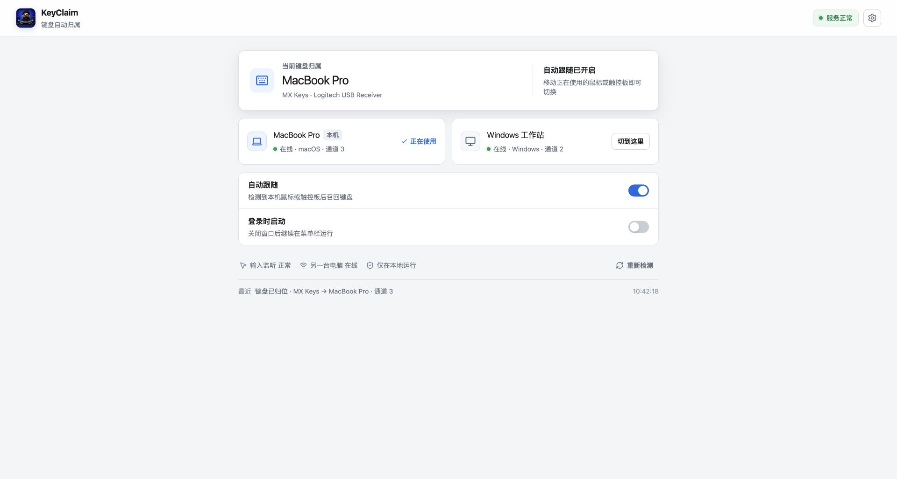

<div align="center">
  
  <h1>KeyClaim</h1>
  <p>让 MX Keys 自动跟随你正在使用的电脑。</p>
  <p>移动鼠标或触控板，键盘就在 Windows 与 macOS 之间自动归位。</p>
</div>



## 它解决什么

当一把 MX Keys 分别通过接收器连接 Windows 和 Mac 时，每次切换电脑都要再按一次 Easy-Switch。KeyClaim 在两台电脑上同时运行，判断你正在操作哪一台，然后让当前持有键盘的电脑把键盘切到对应通道。

当前为非哥的设备组合预设：

- Windows 工作站：MX Keys 通道 2，MX Master 3。
- MacBook Pro：MX Keys 通道 3，MX Master 3S 与内置触控板。
- macOS 优先寻找 PID `0xC52B` 的 Unifying 接收器，避免误控制 PID `0xC548` 的 Bolt 鼠标。

## 工作方式

```text
鼠标或触控板产生本地输入
            ↓
目标电脑通过局域网发起签名召回
            ↓
当前持有键盘的电脑确认目标在线、就绪
            ↓
Logitech HID++ ChangeHost 切换 MX Keys 通道
```

- 只有实际指针活动才会触发，不会因电脑单纯唤醒而切换。
- 另一台电脑离线或未就绪时不发送错误指令。
- 没有 2 秒锁定，默认仅使用 60ms 输入防抖。
- 关闭窗口后继续驻留菜单栏，可选开机自动运行。
- 配置、输入状态与运行记录只保存在本机。

## 界面

KeyClaim 是一个单任务后台工具，主界面只保留五件事：

1. 当前键盘归属。
2. 两台电脑的在线状态与通道。
3. 手动切换兜底。
4. 自动跟随与开机自动运行。
5. 输入监听、局域网和最近一次动作状态。

高级配置通过右上角设置按钮或 `⌘,` / `Ctrl+,` 打开。

## 快速开始

### 环境要求

- Node.js 20 或更高版本
- Rust stable
- macOS 12 或更高版本，或 Windows 10 / 11
- 两台电脑处于同一局域网

### 本地开发

```bash
cd $HOME/KeyClaim
npm install
npm run tauri dev
```

Codex 或终端只需要把工作目录指向项目根目录，不必为项目额外创建一种特殊终端。

### macOS 构建

```bash
npm run tauri build -- --bundles app
```

应用生成在：

```text
src-tauri/target/release/bundle/macos/KeyClaim.app
```

当前 Mac 已安装到：

```text
/Applications/KeyClaim.app
```

### Windows 构建

在 Windows PowerShell 的项目根目录执行：

```powershell
npm install
npm test
npm run tauri build
```

Windows 端需要与 Mac 使用相同配对码，并把本机通道设为 `2`。

如果 Windows 端没有被 Mac 识别，先让 Windows Codex 在项目根目录执行只读诊断：

```powershell
powershell -ExecutionPolicy Bypass -File .\scripts\diagnose-windows.ps1
```

脚本只读取 KeyClaim 进程、UDP `45823` 监听、防火墙规则、网卡、配置摘要和 Logitech HID 设备，不会输出配对码，也不会修改系统设置。

## 验证

```bash
npm test
npm run build
cargo fmt --manifest-path src-tauri/Cargo.toml -- --check
cargo test --manifest-path src-tauri/Cargo.toml
```

自动化测试覆盖配置交互、签名消息往返、错误配对码拒绝和非法通道保护。真实 Logitech 接收器探测测试默认忽略，只在键盘已唤醒且需要硬件验收时手动运行。

## 项目结构

```text
KeyClaim/
├─ docs/                       架构、设计规范与 README 素材
├─ public/                     前端品牌资源
├─ src/                        React 单页界面与 Tauri 调用
├─ src-tauri/src/runtime.rs    输入监听、双端心跳与召回状态机
├─ src-tauri/src/protocol.rs   HMAC-SHA256 局域网消息协议
├─ src-tauri/src/logitech.rs   Windows HIDAPI 后端
└─ src-tauri/src/native/       macOS IOKit HID++ 后端
```

更完整的实现说明见 [技术架构](docs/ARCHITECTURE.md)，界面原则见 [设计规格](docs/design/SPEC.md)。

## 权限与隐私

KeyClaim 不包含账号、云服务、遥测或公网中继。局域网消息使用双方相同的配对码签名，过期消息会被拒绝。macOS 端只读取系统公开的当前光标位置，不监听键盘输入，也不需要“辅助功能/设备控制和数据访问”权限；首次联网时仍可能出现系统的本地网络访问提示。

配对码用于局域网内设备认证，不应复用任何账号密码。应用设置保存在系统应用数据目录，不进入 Git 仓库。

## 当前阶段

当前版本为 `0.1.5`。它修复接收器暂时离线后残留旧通道、多网卡环境下广播回程不稳定，以及 macOS 拒绝 HID 访问时界面仍错误显示“服务正常”的问题。macOS 端会先只读检查“输入监控”授权；未授权时不会每 2 秒反复尝试打开接收器，只有用户点击“前往允许”时才调用系统授权接口。Mac 应用已经完成本机构建和安装验证；Windows 安装包以及真实双机的睡眠、唤醒、离线和连续往返切换仍需在 Windows 实体机上完成最终验收。

第一版输入判定基于全局光标位移，因此 Mac 触控板可以触发；远程控制或模拟鼠标输入过滤仍是实验性能力。macOS 使用无需辅助功能授权的 AppKit 光标位置 API，Windows 继续使用系统指针查询；如需严格区分物理与模拟输入，再分别下沉到原生事件来源。

当前构建为本机临时签名，尚未进行 Apple Developer ID 签名、公证或自动更新发布。

## 开源声明

HID++ 协议实现参考 `mxswitch`（MIT），详见 [THIRD_PARTY_NOTICES.md](THIRD_PARTY_NOTICES.md)。

## 许可证

当前仓库为私有项目，尚未添加开源许可证。未经许可，不代表可以复制、分发或商用。
